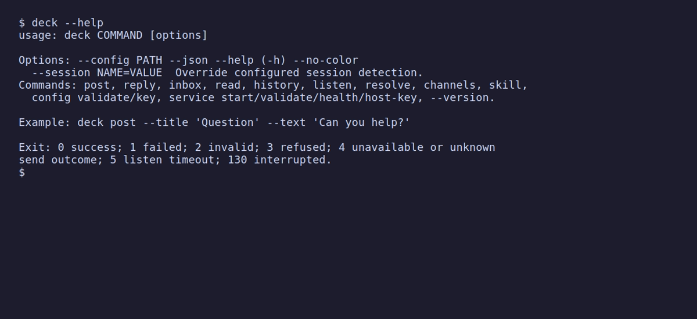

# Command reference

Generated from the running CLI's parser and help.



## deck

```text
usage: deck COMMAND [options]

Options: --config PATH --json --help (-h) --no-color
  --session NAME=VALUE  Override configured session detection.
Commands: post, reply, inbox, read, history, listen, resolve, channels, skill,
  config validate/key, service start/validate/health/host-key, --version.

Example: deck post --title 'Question' --text 'Can you help?'

Exit: 0 success; 1 failed; 2 invalid; 3 refused; 4 unavailable or unknown
send outcome; 5 listen timeout; 130 interrupted.
```

## post

```text
usage: deck post [CHANNEL] --title TITLE [content flags]

Options: --config PATH --json --help (-h) --no-color
Command options: --title --tag --text --text-file --mention --mention-role
--embed --components --poll --answer --poll-duration --poll-multiselect --file
--persona --no-persona --nonce
  --session NAME=VALUE  Override configured session detection.
Content: --text TEXT | --text-file PATH (- for stdin), --mention USER,
  --mention-role ROLE, --embed PATH, --components PATH, --file PATH,
  --poll QUESTION --answer TEXT [--poll-duration 24h] [--poll-multiselect],
  --persona NAME | --no-persona, --nonce NONCE (explicit repeat).

Example: deck post --title 'Question' --text 'Can you help?'

Exit: 0 success; 1 failed; 2 invalid; 3 refused; 4 unavailable or unknown
send outcome; 5 listen timeout; 130 interrupted.
```

## reply

```text
usage: deck reply THREAD [--reply-to MESSAGE] [content flags]

Options: --config PATH --json --help (-h) --no-color
Command options: --reply-to --text --text-file --mention --mention-role
--embed --components --poll --answer --poll-duration --poll-multiselect --file
--persona --no-persona --nonce
  --session NAME=VALUE  Override configured session detection.
Content: --text TEXT | --text-file PATH (- for stdin), --mention USER,
  --mention-role ROLE, --embed PATH, --components PATH, --file PATH,
  --poll QUESTION --answer TEXT [--poll-duration 24h] [--poll-multiselect],
  --persona NAME | --no-persona, --nonce NONCE (explicit repeat).

Example: deck reply 1571484634081529857 --text 'Thank you'

Exit: 0 success; 1 failed; 2 invalid; 3 refused; 4 unavailable or unknown
send outcome; 5 listen timeout; 130 interrupted.
```

## inbox

```text
usage: deck inbox [--all]

Options: --config PATH --json --help (-h) --no-color
Command options: --all
  --session NAME=VALUE  Override configured session detection.

Example: deck inbox --all

Exit: 0 success; 1 failed; 2 invalid; 3 refused; 4 unavailable or unknown
send outcome; 5 listen timeout; 130 interrupted.
```

## read

```text
usage: deck read [THREAD...] [--keep-unread] [--limit N]

Options: --config PATH --json --help (-h) --no-color
Command options: --keep-unread --limit
  --session NAME=VALUE  Override configured session detection.

Example: deck read --keep-unread

Exit: 0 success; 1 failed; 2 invalid; 3 refused; 4 unavailable or unknown
send outcome; 5 listen timeout; 130 interrupted.
```

## history

```text
usage: deck history THREAD [--after MESSAGE | --before MESSAGE] [--limit N]

Options: --config PATH --json --help (-h) --no-color
Command options: --after --before --limit
  --session NAME=VALUE  Override configured session detection.

Example: deck history 1571484634081529857 --limit 50

Exit: 0 success; 1 failed; 2 invalid; 3 refused; 4 unavailable or unknown
send outcome; 5 listen timeout; 130 interrupted.
```

## listen

```text
usage: deck listen [THREAD...] [--timeout DURATION] [--keep-unread]

Options: --config PATH --json --help (-h) --no-color
Command options: --timeout --keep-unread
  --session NAME=VALUE  Override configured session detection.

Example: deck listen --timeout 5m

Exit: 0 success; 1 failed; 2 invalid; 3 refused; 4 unavailable or unknown
send outcome; 5 listen timeout; 130 interrupted.
```

## resolve

```text
usage: deck resolve THREAD | deck resolve --event PATH

Options: --config PATH --json --help (-h) --no-color
Command options: --event

Example: deck resolve --event -

Exit: 0 success; 1 failed; 2 invalid; 3 refused; 4 unavailable or unknown
send outcome; 5 listen timeout; 130 interrupted.
```

## channels

```text
usage: deck channels

Options: --config PATH --json --help (-h) --no-color
  --session NAME=VALUE  Override configured session detection.

Example: deck channels --json

Exit: 0 success; 1 failed; 2 invalid; 3 refused; 4 unavailable or unknown
send outcome; 5 listen timeout; 130 interrupted.
```

## skill

```text
usage: deck skill

Options: --config PATH --json --help (-h) --no-color
  --session NAME=VALUE  Override configured session detection.

Example: deck skill

Exit: 0 success; 1 failed; 2 invalid; 3 refused; 4 unavailable or unknown
send outcome; 5 listen timeout; 130 interrupted.
```

## config validate

```text
usage: deck config validate [--config PATH] [--json]
Validate configuration without contacting a server.
Example: deck config validate --config /etc/deck/config.yml
```

## config key

```text
usage: deck config key [--config PATH] [--json]
Print the public SSH key and its SHA256 fingerprint.
Example: deck config key --config /etc/deck/config.yml
```

## service start

```text
usage: deck service start [--config PATH]
Run the configured service until SIGINT or SIGTERM.
Example: deck service start --config /etc/deck/config.yml
```

## service validate

```text
usage: deck service validate [--config PATH] [--json]
Validate configuration without contacting a server.
Example: deck service validate --config /etc/deck/config.yml
```

## service health

```text
usage: deck service health [--config PATH] [--json]
Request the running service's /healthz on the loopback address and print it.
Example: deck service health --config /etc/deck/config.yml
```

## service host-key

```text
usage: deck service host-key [--config PATH] [--json]
Print the public SSH key and its SHA256 fingerprint.
Example: deck service host-key --config /etc/deck/config.yml
```
